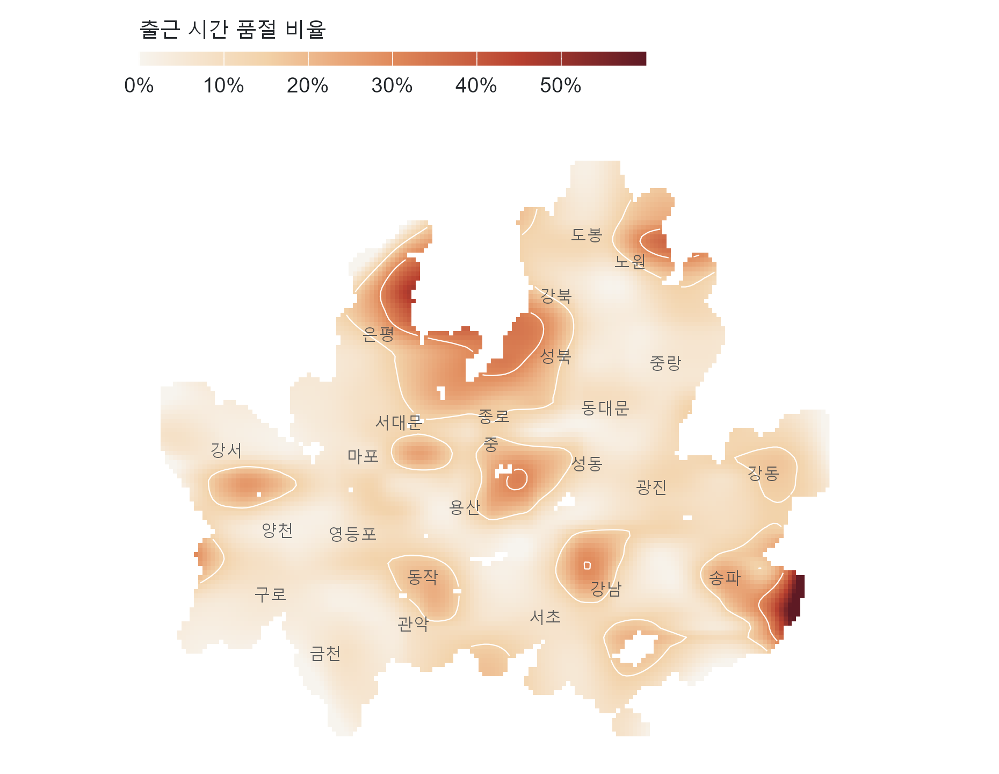
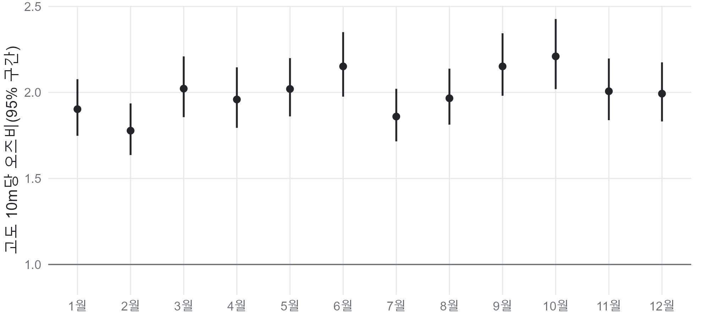

# 줄이기 전에 볼 것: 따릉이가 모자라는 곳은 언덕 위다

서울 공공자전거 따릉이 대여소 2,713곳의 2025년 1년치 이용 기록과 시간별 재고 기록을 결합해,
**출근 시간에 자전거가 없는 대여소가 어디이며 무엇과 관련되는지** 탐색한 프로젝트입니다.

연세대학교 STA3115 탐색적자료분석 기말 프로젝트(2026년 2학기, 1조).

| 보고서 | 분석 노트 | 코드 |
| --- | --- | --- |
| [report/report.pdf](report/report.pdf) (A4 8쪽) | [analysis/eda_analysis.Rmd](analysis/eda_analysis.Rmd) | [scripts/](scripts/) (수집, 집계), [report/report_figures.R](report/report_figures.R) |

## 왜 이 질문인가

따릉이 이용은 2년 연속 줄었고(2023년 4,491만 건에서 2025년 3,737만 건), 서울시는 서울연구원과 함께
적정 규모와 운영 효율화를 다시 연구하고 있습니다. 규모를 줄이는 논의에서는 이용이 적은 대여소부터
통합하자는 안이 먼저 나오기 쉽습니다. 그런데 **이용 건수는 공급에도 좌우됩니다.** 자전거가 없어서
빌리지 못한 수요는 기록에 남지 않습니다. 그래서 줄이기 전에 실제로 모자라는 곳부터 확인했습니다.

## 핵심 결과

출근 품절은 출근 시간(6~10시)에 비가 오지 않은 평일의 7~9시 재고 기록 중 0대였던 비율입니다.

1. **품절은 고지대에 몰려 있다.** 출근 품절 비율은 고도 20m 미만 4.8%, 20~40m 9.5%, 40m 이상 25.1%였습니다.
2. **품절과 가장 크게 관련된 것은 고도다.** 로지스틱 회귀에서 고도가 10m 높아질 때마다 품절이 잦은
   대여소일 오즈는 2.10배(95% 신뢰구간 1.91~2.30)였습니다. 지하철역과 대학까지의 거리는 단독으로는 관련이
   없었고, 거치대가 많을수록 품절이 적었습니다.
3. **이용이 적은 대여소 중 상당수는 공급 부족이다.** 통합 후보 427곳 중 128곳(30%)이 출근 시간에 자주 비는
   대여소였고, 그중 95곳이 고도 40m 이상이었습니다.
4. **경사, 비, 주거지로는 설명되지 않는다.** 경사는 고도를 대신하지 못했고, 비 오는 아침에도 언덕 위는
   거의 그대로 비었으며, 주거 지수를 넣어도 고도 효과는 같았습니다(아래 보강 분석).
5. **1년 내내 같았다.** 달마다 따로 추정한 고도 오즈비가 12개월 모두 1.75~2.18이었고(전체 평일 기준),
   품절 기준을 20%나 40%로 바꿔도 결론이 같았습니다.

<p align="center"></p>
<p align="center"><sub>출근 시간 품절 비율의 level plot(대여소 좌표에 대한 LOESS 곡면). 북쪽 산자락과 동남쪽 끝이 높다.</sub></p>

<p align="center"></p>
<p align="center"><sub>달마다 따로 적합한 로지스틱 회귀의 고도 10m당 오즈비와 95% 신뢰구간.</sub></p>

## 데이터

모두 공개 데이터입니다. 분석 기간은 2025년 평일 244일(공휴일 17일 제외)입니다.

| 데이터 | 단위 | 쓰임 |
| --- | --- | --- |
| 따릉이 대여소별 대여/반납 승객수 (서울 열린데이터광장 OA-21229) | 대여소 간 이동, 5분 | 이용량, 순변화 |
| 대여소별 대여가능 수량 (OA-22382) | 대여소 재고, 1시간 | 출근 품절 |
| 공공자전거 이용정보 월별 (OA-15248) | 월 x 연령대 | 이용 추이(2022-01~2026-06) |
| 실시간 대여정보 API (OA-15493), 대여소 정보 (OA-13252) | 대여소 | 좌표, 거치대 수, 자치구, ID 연결 |
| 서울시 지하철역 정보 API (784곳), 서울시 대학 목록 (53곳) | 지점 | 역과 대학까지 거리 |
| Open-Meteo Elevation API (Copernicus DEM 90m) | 지점 | 대여소 고도 |
| Copernicus DEM GLO-30 (30m, AWS 공개 저장소) | 30m 격자 | 대여소 주변 경사, 주변 대비 상대 고도 |
| 기상청 방재기상관측(AWS) 시간 자료 (기상자료개방포털, 서울 27곳) | 관측소, 1시간 | 비 오는 출퇴근 시간 제외, 기온, 풍속 |
| 서울 생활인구(내국인, 행정동 단위 OpenAPI), 행정동 경계(vuski/admdongkor) | 행정동, 1시간 | 주거 지수(새벽 인구 ÷ 낮 인구) |
| 서울시 1:5000 수치지도 등고선, 표고점 | 선, 점 | 건물을 뺀 지표면 고도, 경사 |

까다로웠던 점:
- 이동 데이터에는 같은 이용이 출발 기준과 도착 기준으로 두 번 들어 있습니다. 대여는 출발 기준 행만, 반납은 도착 기준 행만 셉니다.
- 이동 데이터(ST-xxx)와 재고 데이터(5자리 번호)의 대여소 ID 체계가 달라 실시간 대여정보 API로 연결했습니다.
- 2025년 7월 파일만 영어 열 이름이고, 파일마다 인코딩(cp949, utf-8)이 섞여 있어 파일별로 판별합니다.

## 방법

수업에서 다룬 탐색적 자료분석(Cleveland, *Visualizing Data*) 방법을 연구 질문마다 썼습니다.

| 질문 | 방법 |
| --- | --- |
| 어디에 몰려 있나 | 대여소 좌표에 대한 LOESS 곡면과 level plot, 고도 구간별 비교 |
| 무엇과 함께 움직이나 | LOESS 산점도와 잔차 그림, 지하철역 거리 사분위별 coplot, 상호작용을 넣은 로지스틱 회귀 |
| 이용이 적은 곳 중 공급 부족은 | 이용량 로그 변환과 분포 비교, 대여소 역할 분류, 모자이크 그림과 카이제곱 검정 |
| 1년 내내 같은가 | 월별 상관, 월별 로지스틱 회귀, 품절 기준값(20%, 30%, 40%) 민감도 |
| 높이인가 경사인가 | 지형 변수 산점도 행렬, 고도 LOESS 잔차와 경사, 오르막의 잔차 의존 그림, 고도 사분위별 coplot, AIC 비교 |
| 날씨 때문인가 | 비 온 출근 시간과 맑은 출근 시간 품절의 Tukey 평균-차이 그림 |
| 주거지라서인가 | 주거 지수(생활인구 새벽 ÷ 낮) 3분위별 coplot |
| 구 단위로는 | 구별 평균 경사와 대여소당 대여의 산점도와 LOESS |

## 폴더

| 폴더 | 내용 |
| --- | --- |
| `scripts/` | 데이터 수집과 집계(Python 표준 라이브러리, R, Node.js, 01~10 순서) |
| `data/` | 분석이 읽는 집계 파일과 각 단계 로그. 처음 만든 2025년 10월 한 달 결과는 `data/oct2025/`에 보관 |
| `analysis/` | R Markdown 탐색 분석(`eda_analysis.Rmd`, 13개 절)과 그림, 보강 분석 스크립트와 로그 |
| `report/` | 논문형 보고서(HTML, PDF), 보고서용 그림 코드, PDF 생성 스크립트 |
| `viz/` | 구별 시간대 대여 지도(HTML 한 장, `python viz/build_gu_hourly_map.py`로 생성) |
| `slides/` | 15분 발표 슬라이드 원본(`deck/`), 발표용 그림(한글, 16:9)과 그림 코드, 로그 |
| `raw/` | 원천 파일(약 2.2GB). 저장소에는 올리지 않음(`.gitignore`) |

## 발표 그림 (`slides/figures/`, `slides/figures_en/`)

EDA 노트의 그림 가운데 발표 흐름에 맞는 것을 골라 큰 글씨로 다시 그렸습니다(`slides/slide_figures.R`).
같은 코드가 한국어판(`slides/figures/`, Noto Sans KR)과 영어판(`slides/figures_en/`, Segoe UI)을 만들고, 발표는 영어판을 씁니다.
그림 안에는 제목을 넣지 않고, 슬라이드 제목으로 아래 문장을 씁니다. 고도는 모두 90m 격자 고도이고,
경사와 오르막은 건물을 뺀 지표면 기준입니다. 고도 80m를 넘는 대여소 20곳은 수가 적어 곡선 그림에서 뺐습니다.

| 발표 순서 | 파일 | 슬라이드 제목 | 방법 |
| --- | --- | --- | --- |
| 5 | `02_elevation_loess.png` | 높은 대여소일수록 출근 시간에 비어 있다 | LOESS |
| 6 | `03_map.png` | 품절은 언덕 지역에 모여 있다 | level plot(LOESS 곡면) |
| 7 | `05a_candidates_by_elevation.png` | 40m 이상 통합 후보의 절반은 이미 아침에 빈다 | 누적 막대 |
| 9 | `04_coplot_subway.png` | 점검 1: 지하철역이 가깝든 멀든 같은 모양이다 | coplot |
| 10 | `06_residual_slope_climb.png` | 점검 2: 가파른 정도가 아니라 얼마나 올라가야 하느냐다 | 잔차 의존 그림 |
| 11 | `07_tukey_rain.png` | 점검 3: 비가 와도 언덕 위는 비어 있다 | Tukey 평균-차이 그림 |
| 12 | `08_coplot_residential.png` | 점검 4: 주거지든 업무지구든 언덕 위는 빈다 | coplot |
| 부록 1 | `01_scale.png` | 가장 바쁜 18시에도 달리는 자전거는 11%뿐이다 | 시간대별 막대 |
| 부록 2 | `09_gu_slope.png` | 평평한 구일수록 많이 탄다 | 산점도와 LOESS |

그 밖의 부록(질문 대비): `05b_mosaic_roles.png`(역할과 고도 모자이크, 카이제곱 720), `b1_net_change.png`(낮 동안 순변화),
`b2_monthly_bands.png`(월별 고도 구간 품절), `b3_logit_prediction.png`(로지스틱 예측 확률),
`b4_logit_calibration.png`(로지스틱 적합 점검).
색은 덱과 같은 팔레트(파랑 #3182F6, 품절은 빨강 #F04452, 회색 계열)를 씁니다.

### 발표 슬라이드 (`slides/deck/`)

위 그림으로 만든 15분 영어 발표 슬라이드입니다(제목: Look Before You Cut: Seoul’s Public Bikes Run Out on the Hills).
발표 전체가 질문 하나를 따라갑니다. "이용이 적은 대여소는 정말 수요가 적은가, 아니면 자전거가 없는가?"

1. **질문**(1~4장): 표지, 왜 묻는가, 자료, 출근 품절 정의
2. **답**(5~7장): 품절은 고도를 따라 오르고(LOESS, 지도), 통합 후보 427곳 중 128곳이 이미 아침에 빈다
3. **점검**(8~13장): 정말 고도인가? 지하철, 경사, 비, 주거를 하나씩 확인하고, 로지스틱 회귀로 묶는다
4. **제안**(14~16장): 결론과 제안(가장 바쁠 때도 89%가 서 있으니 늘리기보다 옮기기), 한계, 질문

본편 16장과 부록 8장(부록 표지, 규모, 구 단위, 모자이크, 순변화, 월별, 예측 확률, 적합 점검)이고, 장마다 영어 발표자
노트가 있습니다. 디자인은 토스 스타일(흰 바탕, 옅은 파랑 둥근 카드, 큰 굵은 숫자, 파란 강조 하나)이고 글꼴은 Inter(한글은 Noto Sans KR)입니다. 따릉이는 공식 영문 이름 Seoul Bike로 쓰고 처음 나올 때만 "(따릉이)"를 붙였습니다.
슬라이드는 claude.ai의 Slides 형식(장마다 HTML 한 개, 공통 CSS `deck.css`, 목차 `deck.json`)으로 만들었고,
그림은 덱에 올린 `slides/figures_en/`의 PNG를 씁니다.
10장(경사 점검)의 실제 예는 같은 언덕에서 777m 떨어지고 경사가 거의 같은(9.4°, 9.8°) 두 대여소입니다. 위쪽 신금호역 2번출구 앞(68m)은 출근 시간 80%가 비고 하루 2.1건, 아래쪽 금남시장 교차로(24m)는 0.5%가 비고 하루 28.3건입니다(`slides/station_pair.R`).
마지막 장의 Shiny 앱과 GitHub 주소는 아직 비어 있습니다.

## 보강 분석: 비 오는 날을 빼고, 경사와 오르막과 비교 (2026-11-20)

대여소마다 가장 가까운 기상청 관측소(중앙값 2.0km)의 시간 강수로, 출근 시간(6~10시)이나 퇴근 시간(16~20시)에
비가 온 평일과 강수 기록이 빠진 평일을 뺐습니다. 이동 기록으로는 "이 대여소에 도착한 이용이 평균 몇 m를 올라왔나"
(오르막, `climb_in_m`)를 새로 계산했습니다. 결과는 `analysis/dry_compare_log.txt`.

- **비는 결론을 바꾸지 않았습니다.** 비 오는 아침을 뺀 품절 비율과 전체 평일 품절 비율의 상관은 0.998이고,
  고도 10m당 오즈비는 2.10(90m 고도, 95% 구간 1.91~2.30)으로 기존 2.07과 같았습니다.
- **경사는 고도를 대신하지 못했습니다.** 대여소 주변 300m 평균 경사(AIC 1580)는 고도(1365)보다 설명력이 낮고,
  둘을 함께 넣으면 경사의 효과가 사라집니다(오즈비 0.90, 95% 구간 0.77~1.05).
- **가장 잘 설명한 것은 오르막입니다.** 오르막 하나만 넣은 모형이 가장 좋았고(AIC 1352),
  고도와 오르막을 함께 넣으면 둘 다 남습니다(AIC 1336, 1 표준편차당 오즈비 1.71과 1.91).
  대여소가 높은 곳에 있는지와, 실제 이용이 그곳까지 얼마나 올라와야 하는지가 각각 품절과 관련됩니다.
- **저녁(17~19시)에도 같은 곳이 빕니다.** 퇴근 품절도 고도와 상관이 높습니다(스피어만 0.52).
- **비 오는 아침에도 언덕 위는 거의 그대로 빕니다.** 출근 시간에 비가 오면 아침 대여는 51~89% 줄지만
  (`analysis/weather_checks_log.txt`, 구역, 월, 요일 통제), 고도 40m 이상 대여소의 품절은 25.1%에서 20.8%로만 줄고
  고도 오즈비도 1.87로 남습니다. 품절은 그날 수요보다 아침 전에 언덕 위로 자전거가 다시 채워지지 않는 구조에서 생깁니다.
- **건물을 뺀 지형으로도 같습니다.** 서울시 1:5000 수치지도의 등고선과 표고점으로 지표면 고도를 만들어
  다시 계산했습니다(`scripts/12_dem_contour.R`, `analysis/bare_compare_log.txt`). 건물이 섞인 Copernicus 고도는
  중앙값 2.2m 높았고 경사는 두 배로 부풀어 있었지만, 지표면 경사도 고도를 대신하지 못했고(함께 넣으면 오즈비 0.94,
  95% 구간 0.80~1.11), 지표면 고도로 계산한 오르막이 여전히 가장 잘 설명했습니다(AIC 1335). 지표면 고도 10m당
  오즈비는 2.30(2.08~2.54)입니다.
- **"언덕 위가 주거지라서"가 아닙니다.** 서울 생활인구(행정동별, 2026년 6~7월 평일 10일)로 동마다
  새벽 인구 ÷ 낮 인구(주거 지수)를 만들어 대여소에 붙였습니다(`scripts/14_living_population.py`,
  `analysis/residential_check_log.txt`). 고지대가 조금 더 주거지이긴 하지만(순위상관 0.17), 주거 지수를 넣어도
  고도 효과는 그대로이고(1 표준편차당 오즈비 3.03에서 3.01) 주거 지수 자체의 효과는 사라집니다(1.08, 0.94~1.25).
  업무지구에 가까운 동에서도 고도 10m당 오즈비가 2.67로, 언덕 위는 주거지든 아니든 빕니다.
- **구 단위로는 평평한 구일수록 많이 탑니다.** 대여소 평균 경사가 1도 높은 구일수록 대여소당 대여가 17.5% 적고
  (25개 구, R2 0.45), 이용 상위 3개 구(강서, 송파, 영등포)의 평균 경사는 1.6도로 나머지(3.7도)의 절반 아래입니다
  (`analysis/gu_terrain_log.txt`). 경사는 이용 수준과, 고도와 오르막은 품절(불균형)과 관련됩니다.
- 날씨와 이용: 아침 기온 0도 미만이면 아침 대여가 24% 줄고 25~30도면 14% 늘며, 풍속 4m/s 이상이면 21% 줄었습니다.

진행 중:
- R Shiny 앱 5개 탭(현황, 규모, 흐름, 품절, 대여소)을 만들어 shinyapps.io에 배포할 예정입니다(`app/`).

## 재현 방법

필요한 것: Python 3, R 4.x(tidyverse, broom, vcd, rmarkdown, terra), Node.js 22 이상, 서울 열린데이터광장 인증키(텍스트 파일 하나에 저장).

1. 원천 파일을 받아 `raw/`에 둡니다.

   | 폴더 | 파일 | 원천 |
   | --- | --- | --- |
   | `raw/od_5min/` | 202501.zip ~ 202512.zip | OA-21229 |
   | `raw/inv_1h/` | 2025Q1.zip ~ 2025Q4.zip | OA-22382 |
   | `raw/usage_monthly/` | 월별 이용 CSV | OA-15248 |
   | `raw/stations/csv/` | info_2606__대여소현황.csv | OA-13252 |
   | `raw/map/` | bikelist_map.csv(실시간 대여정보 API의 대여소 ID와 번호) | OA-15493 |
   | `raw/dem/` | cop30_N37_00_E126_00.tif, cop30_N37_00_E127_00.tif | Copernicus DEM GLO-30 |
   | `raw/contour/` | 서울시 1:5000 수치지도 등고선(N3L_F001), 표고점(N3P_F002) 셰이프파일 | 서울 열린데이터광장 "서울시 경사도"(현재 서비스 종료) |
   | `raw/admdong/` | HangJeongDong_ver20250701.geojson(행정동 경계) | github.com/vuski/admdongkor |
   | `raw/weather/` | aws_202501.csv ~ aws_202512.csv(`scripts/08_fetch_kma_aws.mjs`로 받음) | 기상청 방재기상관측 |

2. 대여소 특성을 만들고 집계합니다. 인증키는 파일 경로로만 넘기고 화면에 출력하지 않습니다.

   ```
   python scripts/01_fetch_features.py raw/map/bikelist_map.csv <인증키 파일> data
   python scripts/02_universities.py <인증키 파일> data/universities.csv
   python scripts/03_clean_universities.py data/universities.csv data/universities_clean.csv
   python scripts/04_station_features.py data "raw/stations/csv/info_2606__대여소현황.csv"
   python scripts/05_aggregate.py data raw/od_5min/202510.zip raw/inv_1h/2025Q4.zip raw/usage_monthly
   python scripts/06_aggregate_year.py data raw/od_5min raw/inv_1h
   Rscript scripts/07_terrain.R
   node scripts/08_fetch_kma_aws.mjs ...   (기상자료개방포털 로그인 필요, 사용법은 스크립트 머리말)
   python scripts/09_weather_daily.py raw/weather data
   python scripts/10_aggregate_dry.py data raw/od_5min raw/inv_1h
   Rscript analysis/dry_compare.R > analysis/dry_compare_log.txt
   python scripts/11_weather_checks.py inv data raw/inv_1h
   python scripts/11_weather_checks.py od data raw/od_5min
   Rscript analysis/weather_checks.R > analysis/weather_checks_log.txt
   Rscript scripts/12_dem_contour.R > data/12_dem_contour_log.txt
   python scripts/13_od_pairs.py data raw/od_5min raw/derived
   Rscript analysis/bare_compare.R > analysis/bare_compare_log.txt
   python scripts/14_living_population.py <인증키 파일> data
   Rscript analysis/residential_check.R > analysis/residential_check_log.txt
   Rscript analysis/gu_terrain.R > analysis/gu_terrain_log.txt
   ```

   05는 10월 한 달 집계와 연령대 추이(`monthly_age.csv`)를 만들고, 06이 대여소 집계를 1년 기준으로 덮어씁니다.

3. 분석과 보고서를 만듭니다.

   ```
   Rscript -e "rmarkdown::render('analysis/eda_analysis.Rmd')"
   cd report && Rscript report_figures.R
   powershell -File report/make_pdf.ps1
   Rscript slides/slide_figures.R ko > slides/slide_figures_log.txt
   Rscript slides/slide_figures.R en > slides/slide_figures_en_log.txt
   ```

   PDF는 Microsoft Edge의 headless 인쇄로 만들고, Noto Serif KR과 Noto Sans KR 글꼴이 설치돼 있어야 합니다.

## 변수 정의 (`data/stations.csv`)

| 변수 | 뜻 |
| --- | --- |
| `use_day` (Y1) | 평일 하루 평균 대여+반납 건수 |
| `net_day` (Y2) | 평일 하루 평균 반납 − 대여. 음수면 자전거가 빠져나가는 곳 |
| `am_empty` (Y3) | 평일 7~9시 매시 재고 기록 중 0대였던 비율 |
| `dep_day`, `arr_day` | 평일 하루 평균 대여, 반납 |
| `commute_share` | 평일 대여 중 7~9시, 17~19시 비율 |
| `parked_08` | 평일 8시 평균 재고 |
| `elev_m` | 고도(m) |
| `subway_m`, `subway_name` | 가장 가까운 지하철역까지 거리(m)와 역 이름 |
| `univ_m`, `univ_name` | 가장 가까운 대학 캠퍼스까지 거리(m)와 이름 |
| `nearest_station_m` | 가장 가까운 다른 대여소까지 거리(m) |
| `docks` | 거치대 수 |
| `gu`, `gu_filled` | 자치구. 신설 13곳은 가장 가까운 대여소의 자치구로 채우고 `gu_filled = 1` |
| `months_active` | 2025년 중 이용이 있었던 달 수. 0인 23곳은 분석에서 제외 |
| `role` | 아래 기준의 대여소 역할 |

역할 기준(서울 전체 분포 기준): 이용 하위 20%(`use_day` 24.2건 이하)이고 300m 안에 다른 대여소가 있으면 통합 후보,
그중 `am_empty` 0.3 이상이면 `supply_gap_suspect`(공급 부족 의심), 나머지는 `consolidate`(통합 검토).
통합 후보가 아니면서 `am_empty` 0.3 이상이면 `morning_gap`, 이용이 중앙값(58.4건) 이상이고 `commute_share` 0.5 이상이면 `commute_core`.

다른 집계 파일: `station_month.csv`(대여소 x 월), `station_hour.csv`(대여소 x 평일/주말 x 시간),
`district_hour.csv`(자치구 x 시간의 서 있는 자전거와 타는 자전거), `monthly_age.csv`(월 x 연령대), `coverage_2025.csv`(월별 수집 범위).

## 한계

- 인과를 주장하지 않습니다. 생활인구로 만든 주거 지수를 넣어도 고도 효과는 그대로였지만, 관측하지 못한 동네 차이가 있을 수 있습니다.
- 자전거가 없어서 못 빌린 수요는 관측되지 않습니다. 이용량은 공급의 영향을 받습니다.
- 재고는 한 시간에 한 번 찍힌 값이라 한 시간 안의 품절은 놓치고, 2025년 1월은 이틀치가 비어 있습니다.
- 대학 목록은 2013년 기준 서울시 자료입니다. 원격 대학, 통합된 학교, 위치를 확인하지 못한 곳은 뺐습니다(`data/03_universities_log.txt`).
- 적정 대수 자체는 추정하지 않았습니다.
